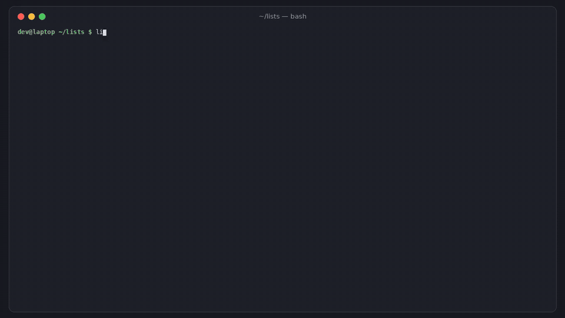

# listwarden

[](https://github.com/hamarshehmhmd/listwarden/actions/workflows/ci.yml)
[](LICENSE)


**Keep awesome lists awesome.** Find the dead, archived, renamed and abandoned entries in a curated list, fix the easy ones automatically, and get the facts on every link a pull request adds (and on who's adding it).



```sh
curl -fsSL https://raw.githubusercontent.com/hamarshehmhmd/listwarden/main/install.sh | sh
```

## Why

["Awesome repositories are no longer awesome"](https://erikgahner.github.io/posts/2026/awesome-repositories-are-no-longer-awesome/) ([HN, Nov 2026](https://news.ycombinator.com/item?id=50377821)) names two problems:

1. **Link rot.** Lists age. Projects get archived, orgs get renamed (`hadley/*` → `tidyverse/*`, `zeit/*` → `vercel/*`), repos get deleted, sites move. [awesome-R](https://github.com/qinwf/awesome-R) (6.5k stars) has 486 entries: 65 repos were renamed, 11 are archived and 55 have had no commits for two years.
2. **PR floods.** Submitting a link costs a script nothing, and vetting it costs a maintainer real time. The post found one account that sent 100+ PRs to awesome lists, all for its own sites. A small repo with 13 stars had 91 open PRs.

Link checkers (awesome_bot, lychee) tell you a URL returns 200. They don't tell you the repo behind it was archived in 2021, that it's listed twice, or that the person adding it has opened PRs to dozens of other lists this week.

## What it does

| Command | |
|---|---|
| `listwarden audit [FILE \| owner/repo]` | Every entry in the list: **dead** (deleted repo, 404, DNS gone), **archived**, **renamed** (GitHub redirect), **moved** (site redirects elsewhere), **stale** (no commits in N months), **duplicate**, **fork**. Bot-blocked sites (403/429) and login-walled ones (X, LinkedIn…) are reported as *unverified*, never as dead. |
| `listwarden fix FILE` | Rewrites renamed repos and permanent (301/308) redirects to the new URL. `--prune dead,archived` also drops those entries. Dry-run diff by default, `--write` to apply. Only the exact URL on the affected line is touched. |
| `listwarden pr owner/repo NUMBER` | Reads only the lines a PR **adds** (moved lines are ignored) and prints facts per new link: stars, repo age, last commit, commits, contributors, license, already listed?, submitted by the owner? Then the submitter: account age, PRs to *other* awesome lists in the last 7 days, how many PRs pitched the same link. `--comment` posts one sticky comment. |
| GitHub Action | PR mode on `pull_request_target`, weekly audit on `schedule`, results in the job summary. |

All GitHub repos are looked up in batched GraphQL calls (40 per request), so a 500-entry list costs a handful of API calls. Web links are checked in parallel with HEAD → GET fallback, at most 4 at a time per host.

It reports **facts, not verdicts**. A brand-new repo with 2 stars might be the best thing on the list; the maintainer decides.

## Usage

```sh
listwarden audit                          # ./README.md
listwarden audit qinwf/awesome-R          # any public list on GitHub (owner/repo[:path])
listwarden audit --no-web                 # GitHub repos only (fast)
listwarden audit --stale-months 36 --ignore web.archive.org
listwarden audit --format markdown        # or json
listwarden audit --fail-on dead,archived  # exit 1 if any (default: dead; 'any' / 'none')

listwarden fix                            # show the diff
listwarden fix --prune dead,archived --write

listwarden pr sindresorhus/awesome 1234
listwarden pr https://github.com/owner/awesome-x/pull/56 --format markdown
listwarden pr owner/awesome-x 56 --min-stars 25 --min-age-days 60 --blast-threshold 5 --fail-on warn
listwarden pr --diff change.diff --repo owner/awesome-x --author someone --base README.md   # offline diff
```

Example (`listwarden audit qinwf/awesome-R --no-web`, Nov 2026):

```
qinwf/awesome-R:README.md: 486 entries (205 GitHub repos, 281 other links)
  L427   dead      BZRLC/R-notes            repository not found (deleted, private or never existed)
  L129   duplicate r-lib/vroom              also listed on line 66
  L175   archived  rstudio/ggvis            archived, last commit 9mo ago
  L297   archived  twitter/AnomalyDetection archived, last commit 11.2y ago
  ...
79/205 checked entries healthy · 2 dead, 11 archived, 27 duplicate, 65 renamed, 55 stale, 5 fork · 65 auto-fixable (listwarden fix)
```

Example PR check (from the test fixtures; names are made up):

```
lists/awesome-widgets#42  by @newbie  “Add shinytool”
  + newbie/shinytool  (README.md)
      ★ 2 · created 6d ago · last commit 4d ago · 3 commits · 1 contributor · no license
      WARN  repo created 6 days ago (< 30)
      WARN  2 stars (< 10)
      INFO  submitted by the repo owner (self-promotion is fine if disclosed)
      WARN  newbie mentioned newbie/shinytool in 23 PRs across GitHub
  + acme/goodlib  (README.md)
      FAIL  already listed in README.md (line 1)
  @newbie: account 20d old · 14 PRs in last 7d, to 11 other awesome lists
      WARN  opened PRs to 11 other awesome lists in the last 7 days
result: FAIL
```

### Token

A token makes it fast (GraphQL batching) and avoids the 60 requests/hour anonymous limit. listwarden uses `LISTWARDEN_TOKEN`, `GITHUB_TOKEN` or `GH_TOKEN`, then `gh auth token` if the GitHub CLI is logged in. Read-only public access is enough; `--comment` needs `pull-requests: write`.

## GitHub Action

```yaml
# .github/workflows/listwarden.yml
name: listwarden
on:
  pull_request_target:        # base repo token; listwarden reads the PR via the API and never runs PR code
    types: [opened, synchronize, reopened]
  schedule:
    - cron: "17 6 * * 1"      # weekly link-rot audit
permissions:
  contents: read
  pull-requests: write
jobs:
  listwarden:
    runs-on: ubuntu-latest
    steps:
      - uses: actions/checkout@v5     # base branch only
      - uses: hamarshehmhmd/listwarden@v0.1.0
        with:
          fail-on: none               # comment only; 'fail' blocks dead/duplicate/archived links
          args: ""                    # e.g. --min-stars 25 --blast-threshold 5
```

Inputs: `mode` (`pr`/`audit`, auto by event), `file` (audit, default `README.md`), `comment` (default `true`), `fail-on`, `args`, `token`.

## Demo

The narrated demo video (2–3 min) is attached to the [v0.1.0 release](https://github.com/hamarshehmhmd/listwarden/releases/tag/v0.1.0). It runs `audit` and `fix` live against awesome-R, and `audit`/`pr` against the recorded fixtures in `tests/fixtures/` (made-up names). Rebuild it with `python demo/render.py` (needs ffmpeg, edge-tts, Pillow).

## Install

```sh
curl -fsSL https://raw.githubusercontent.com/hamarshehmhmd/listwarden/main/install.sh | sh
# or
pipx install git+https://github.com/hamarshehmhmd/listwarden
uv tool install git+https://github.com/hamarshehmhmd/listwarden
```

Python 3.9+, no dependencies. The installer uses `uv tool`, then `pipx`, then a private venv in `~/.local/share/listwarden`.

## Limits

- Facts, not judgment. Thresholds (`--min-stars`, `--min-age-days`, `--blast-threshold`) are heuristics; tune them for your list.
- Sites that block bots (403/429/503) or need a login can't be verified and are reported as such, so check those by hand.
- The "PRs to other awesome lists" count comes from GitHub search (first 100 results, 30 searches/min). It counts repos with `awesome` in the name.
- Deep checks (archived, renamed, stale, stars) only exist for GitHub repos. GitLab/Codeberg links get a plain HTTP check.
- Entries are list items and table rows. The first external link on each line is treated as the entry.

## Development

```sh
python -m pip install -e . pytest
python -m pytest -q
```

Tests run offline against a recorded cassette (`tests/fixtures/cassette.json`). CI also runs a live audit and PR check against GitHub.

## License

[GNU AGPL-3.0-or-later](LICENSE). Commercial licenses without the AGPL obligations are available from the author: contact [@hamarshehmhmd](https://github.com/hamarshehmhmd).
